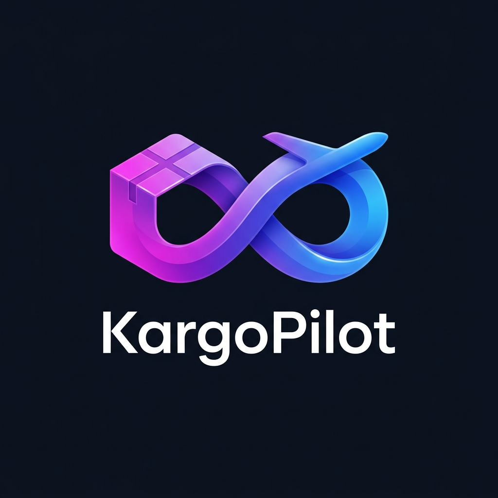
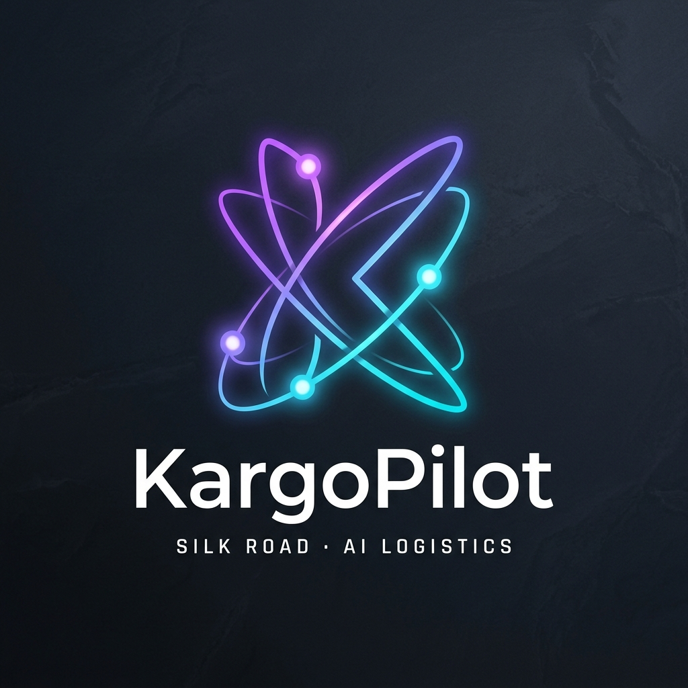

<div align="center">
  
  <br/><br/>
  <h1>⚡ KargoPilot v6.5.0 Enterprise</h1>
  <p><b>Dual-Hosting AI Copilot for Cross-Border Logistics, 4-Channel Unified Connection Health Matrix, 1-Click Session Quick-Bridge, Multi-Tenant Auth, Smart Arbitrage & DGK SmartCustoms Read-Only 300$ Quota Liveness</b></p>
  <p><i>Təqdim olunur 2 rejimdə: <b>Variant 1 (Müstəqil Server / Self-Hosted)</b> 100% on-prem məlumat məxfiliyi & <b>Variant 2 (Bulud İdarəetməli / Cloud Managed 7/24)</b> avtonom bulud idarəetməsi.</i></p>

  <p>
    <a href="https://vaskamc.github.io/kargopilot"></a>
    
    
    
    
    
    <a href="LICENSE"></a>
  </p>
</div>

---

## 🎨 Rəsmi İkili Brend Kimliyi (Official Dual-Tier Brand Identity)

KargoPilot transsərhəd logistika və avtonom süni intellekt mühərriki üçün xüsusi olaraq hazırlanmış ikili brend sistemini tətbiq edir:

| Əsas Korporativ Brend (Konsept 6) | AI Mühərriki və Loyd Copilot (Konsept 5) |
| :---: | :---: |
|  |  |
| **Sonsuzluq Kargo və Jet Halqası (Infinity Loop)** | **Böyük İpək Yolu Kvant 'K' Qovşağı (Quantum Node)** |
| Rəsmi korporativ veb başlıq, Admin Kokpit, invoyslar və hüquqi sənədlərdə əsas brend kimliyi | WhatsApp Loyd AI, Telegram Bot, Chrome Extension və neyron köməkçi üçün xüsusi avatar |

---

## 🌐 Canlı Nümayiş Portalı və Demo Hesabı

Rəsmi interaktiv platforma portalı və nümayiş səhifəsi aktivdir:  
👉 **[https://vaskamc.github.io/kargopilot](https://vaskamc.github.io/kargopilot)**

### 🔑 Hazır Canlı Test və Nümayiş Hesabı (Pre-Seeded Demo Account — v6.5):
Sistemin bütün v6.5.0 funksionallıqlarını (4-Kanallı Əlaqə Sağlamlığı Matrisi, 1-Kliklə Sessiya Körpüsü `Quick-Bridge`, Smart Arbitraj, DGK 300$ Read-Only Kvota Nəzarəti, WhatsApp Bildiriş Şlüzü və 4-Kanal Məlumatlı AI Copilot) real vaxtda yoxlamaq üçün hazırlanmış rəsmi demo hesabı:
- **Giriş URL:** `/login` -> `/user/dashboard`
- **E-poçt:** `demo@kargopilot.az`
- **Şifrə:** `KargoPilotDemo2026!` *(həmçinin geriyə uyğunluq üçün `KargoPilot2026!` dəstəklənir)*
- **FİN Kod:** `7KP2026` (Ailə FİN: `7AY2026` — Aygün Məcidli)
- **WhatsApp Şlüz Nömrəsi:** `+994501234567` (`+9945***4567`)
- **Aktiv 4-Kanallı Qoşulmalar (`🟢 Əlaqə Aktualdır` — `overall_health_score: 100%`):**
  1. 🏪 **Mağaza Əlaqəsi:** `Trendyol TR` (1-Kliklə Sessiya Körpüsü və sifariş sinxronizasiyası)
  2. 🚚 **Kargo Əlaqəsi:** `Starex Global` (Xarici anbar və çəki sinxronizasiyası)
  3. 🏛️ **SmartCustoms (DGK Read-Only):** `read_only_safe_mode: True` — Bəyannaməsiz Təhlükəsiz Oxuma Rejimi (`FİN: 7K***26`, `$40.00` qalıq 300$ kvota, `declarations_created: 0`)
  4. 💬 **WhatsApp Bildiriş Şlüzü:** `+9945***4567` (Aktiv bildiriş seçimləri və canlı şlüz ping dəstəyi)

---

## 🏛️ İkili Yerləşdirmə Memarlığı (Dual-Hosting Architecture v6.5)

KargoPilot v6.5.0 istifadəçilərə ilk qarşılama ekranından (`/`, `/onboarding`, `/self-hosted`) başlayaraq məlumatlarının idarə olunmasında tam azadlıq təmin edən iki fərqli arxitekturada təqdim olunur:

```
                            ┌──────────────────────────────────────────────┐
                            │         KargoPilot v6.5.0 Platforması        │
                            └──────────────────────┬───────────────────────┘
                                                   │
                       ┌───────────────────────────┴───────────────────────────┐
                       ▼                                                       ▼
         ┌───────────────────────────┐                           ┌───────────────────────────┐
         │  Variant 1: MÜSTƏQİL      │                           │  Variant 2: BULUD         │
         │  Server (Self-Hosted)     │                           │  İdarəetməli (Cloud)      │
         ├───────────────────────────┤                           ├───────────────────────────┤
         │ • 100% Müstəqil VPS / PC  │                           │ • 7/24 Yüksək Əlçatanlıq  │
         │ • Sıfır Telemetriya       │                           │ • 30 Saniyədə Qeydiyyat   │
         │ • Şəxsi AES-256 Vault     │                           │ • 1-Kliklə Quick-Bridge   │
         │ • Yerli SQLite WAL Bazası │                           │ • Təhlükəsiz Şifrələmə    │
         │ • Açıq Mənbə Nüvəsi       │                           │ • Daimi Yenilənmələr      │
         │ • Tam İxrac / İdxal / Sil │                           │ • Çoxistifadəçili Portal  │
         │ • 1-Klikli Quraşdırma     │                           │ • Multi-Tenant RBAC Rol   │
         │   (`install_sovereign.sh`)│                           │   və Ailə FİN İdarəetməsi │
         └───────────────────────────┘                           └───────────────────────────┘
```

1. **Variant 1 — Müstəqil Server (Self-Hosted / On-Premise):**
   - FİN kodları, xarici sessiya kuki/tokenlərini, kargo hesablarını və bağlama detallarını heç bir üçüncü tərəfə ötürmədən tam öz serverində idarə etmək istəyən korporativ şirkətlər, dropshipperlər və fərdi istifadəçilər üçün.
   - Bütün verilənlər bazası və Fernet şifrələmə açarı lokal serverdə qalır. Sıfır telemetriya.
2. **Variant 2 — Bulud İdarəetməli (Cloud Managed 7/24 SaaS):**
   - Server sazlamaq istəməyən, brauzerdən dərhal daxil olaraq 7/24 avtomatik bağlama sinxronizasiyası, 4-kanallı əlaqə monitorinqi və DGK 300$ kvota nəzarətindən yararlanmaq istəyən geniş istifadəçi kütləsi üçün.
   - Hər bir müştəri üçün izolyasiya edilmiş Fernet AES-256 zərf şifrələməsi və AR "Fərdi məlumatlar haqqında" Qanununa 100% hüquqi uyğunluq.

---

## ⚡ Əsas İmkanlar və Yeniliklər (v6.5.0)

```
                         ┌──────────────────────────────────────────────┐
                         │   4-Kanallı Vahid Əlaqə Sağlamlığı Matrisi   │
                         │  🏪 Mağaza · 🚚 Kargo · 🏛️ DGK · 💬 WhatsApp │
                         └──────────────────────┬───────────────────────┘
                                                │
                      ┌─────────────────────────┴─────────────────────────┐
                      ▼                                                   ▼
         ┌─────────────────────────────┐                    ┌─────────────────────────────┐
         │ 1-Kliklə Quick-Bridge Vault │                    │ Ağıllı Kargo Arbitrajı      │
         │ Fernet AES-256 + SSRF Qoruma│                    │ Həcmi/Faktiki Çəki Analizi  │
         └──────────────┬──────────────┘                    └──────────────┬──────────────┘
                        │                                                  │
                        └─────────────────────────┬────────────────────────┘
                                                  ▼
                         ┌──────────────────────────────────────────────┐
                         │    KargoPilot v6.5.0 İntellekt Mühərriki     │
                         │ • CBAR Mərkəzi Bank Rəsmi Məzənnəsi (1.7000) │
                         │ • SmartCustoms Read-Only Əlaqə & 300$ Kvota  │
                         │ • 1-Click 4-Kanal Sağlamlıq Xülasəsi (0-100%)│
                         │ • 36% Vahid Gömrük Rüsumu Simulyatoru        │
                         │ • WhatsApp Bildiriş Şlüzü & Canlı Ping Testi │
                         │ • 4-Kanal Məlumatlı Loyd AI Copilot          │
                         │ • Tam Məlumat Portativliyi (Export/Wipe/In)  │
                         └──────────────────────┬───────────────────────┘
                                                │
                      ┌─────────────────────────┴─────────────────────────┐
                      ▼                                                   ▼
         ┌─────────────────────────────┐                    ┌─────────────────────────────┐
         │ İstifadəçi Portalı (Bento)  │                    │ İcraçı Admin Kokpiti        │
         │ `/user/dashboard` v6.5 UI   │                    │ `/admin` Telemetriya        │
         │ Ailə FİN İdarəetmə Mərkəzi  │                    │ Gömrük Supervisor və Risk   │
         └─────────────────────────────┘                    └─────────────────────────────┘
```

### 1. 📡 4-Kanallı Əlaqə Sağlamlığı Matrisi və 1-Kliklə Tam Diaqnostika (`GET /api/v1/user/channels/health-summary`)
İstifadəçi panelinin (`/user/dashboard`) yuxarı hissəsində yerləşən 4 yan-yana interaktiv Bento kartı bütün xarici inteqrasiyaların canlı vəziyyətini (`🟢 Əlaqə Aktualdır`, `🟡 OTP Gözləyir`, `🔴 Qoşulmayıb`), ümumi sağlamlıq balını (`overall_health_score: 0-100%`) və gecikmə (`latency_ms`) göstəricilərini tək kliklə (**"🩺 Bütün Əlaqələri Yoxla"**) real vaxtda yoxlayır:

| Kanal | İnteqrasiya Nümunələri | Təhlükəsizlik & Rejim | API Endpoint |
| :--- | :--- | :--- | :--- |
| **🏪 Mağaza Əlaqəsi** | Trendyol, Temu, Amazon, Zara, iHerb | Fernet AES-256 + Quick-Bridge | `POST /api/v1/user/sessions/quick-bridge` |
| **🚚 Kargo Əlaqəsi** | Starex, Camex, Limak, Dynamex, Expargo | Fernet AES-256 + Anbar Sync | `POST /api/v1/user/sessions/{id}/sync` |
| **🏛️ SmartCustoms (DGK)** | Elektron Gömrük 300$ Kvota & Sessiya | **`read_only_safe_mode: True`** (`declarations_created: 0`) | `POST /api/v1/user/smartcustoms/check-connection` |
| **💬 WhatsApp Şlüzü** | `+994XXXXXXXXX` Bildiriş & Canlı Ping | Maskalanmış Nömrə (`+9945***4567`) | `POST /api/v1/user/whatsapp/ping` |

### 2. ⚡ 1-Kliklə Sürətli Sessiya Körpüsü (`POST /api/v1/user/sessions/quick-bridge`)
- Müştəri uzun kuki sətirləri kopyalamadan və ya mürəkkəb konsol əmrləri yazmadan **"⚡ 1-Kliklə Sürətli Sessiya Bağla"** düyməsi ilə aktiv mağaza, kargo və ya SmartCustoms sessiyasını bağlayır.
- Sistem URL-i SSRF süzgəcindən keçirir, sessiya tokenini Fernet 256-bit ilə şifrələyir, identifikatoru maskalayır (`m***@kargopilot.az`, `7K***26`) və dərhal Read-Only əlaqə yoxlaması apararaq statusu `🟢 Əlaqə Aktualdır` (`active`) edir.

### 3. 🏛️ SmartCustoms Read-Only Əlaqə və 300$ Kvota Yoxlayıcısı (`read_only_safe_mode: True`)
- **🔒 Bəyannaməsiz Təhlükəsiz Oxuma Rejimi:** SmartCustoms modulunda **`read_only_safe_mode: True`** tətbiq olunur — sistem **avtomatik gömrük bəyannaməsi göndərmir** (`declarations_created: 0`).
- **Yalnız Əlaqə Aktuallığı və Kvota Monitorinqi:** `POST /api/v1/user/smartcustoms/check-connection` və `POST /api/v1/user/smartcustoms/sync` sorğuları yalnız istifadəçinin FİN kodu üzrə SmartCustoms sessiyasının aktivliyini (`connection_alive: True`, `session_valid: True`) və cari ay üzrə 300$ DGK rüsumsuz limit statusunu yoxlayır.

### 4. ⚖️ Smart Arbitraj (Ağıllı Kargo Daşıyıcı Müqayisəsi)
- **Çoxölçülü Müqayisə:** Əsas kargo daşıyıcıları (Starex, Expargo, Camex, Dynamex, Limak, Mover, KoliPlus) üzrə faktiki çəki və həcmi çəki ($L \times W \times H / 6000$) hesablanaraq böyük olan əsas götürülür.
- **Kateqoriya və Məzənnə:** Standart, Maye/Kosmetika və Elektronika növləri üzrə həm USD, həm də Mərkəzi Bankın (CBAR) rəsmi 1.7000 AZN məzənnəsi ilə ən ucuz daşıyıcı tövsiyə edilir və qənaət məbləği hesablanır.

### 5. 🛡️ Customs Supervisor (DGK 300$ Rüsumsuz Limit Nəzarəti və 36% Simulyator)
- **Aylıq Kvota Qoruyucusu:** Fərdi və ailə FİN kodları üzrə son 30 günlük dövriyyəni izləyərək təhlükəsizlik şkalası təqdim edir:
  - 🟢 **Təhlükəsiz Zona:** < 250 USD
  - 🟡 **Xəbərdarlıq Zonası:** 250 – 290 USD
  - 🔴 **Yüksək Risk:** > 290 USD
- **36% Vahid Gömrük Rüsumu Simulyatoru:** 300 USD limiti aşıldıqda qanunvericiliyə uyğun olaraq aşılan məbləğə 36% vahid rüsum + 15 AZN rəsmiləşdirmə haqqı simulyasiya edilir.

### 6. 🤖 4-Kanal Məlumatlı Loyd AI Copilot (Azərbaycan Dilində Sərbəst Logistika Köməkçisi)
- İstifadəçinin bütün 4 kanalının (`Mağaza`, `Kargo`, `SmartCustoms Read-Only`, `WhatsApp`) canlı qoşulma vəziyyətini, aktiv bağlamalarını, 300$ DGK balansını və gömrük qaydalarını bilən kontekstual süni intellekt köməkçisi (`POST /api/v1/user/ai/chat`).

### 7. 🔒 Məlumat Müstəqilliyi və Portativliyi (Data Portability & Self-Hosted Control)
- **Tam JSON İxracı (Data Export):** Bütün profil, ailə FİN-ləri, xüsusi mağaza/kargo siyahısı və bağlama tarixçəsi tək kliklə JSON formatında yüklənir.
- **Hesabın Təmizlənməsi (Account Wipe):** İstifadəçinin bütün məlumatlarının bazadan birdəfəlik və geri qaytarılmaz şəkildə silinməsi (Right to be Forgotten).
- **Təhlükəsiz İdxal (Data Import):** İxrac edilmiş məlumatların yoxlanaraq yenidən sistemə bərpası.

---

## 💰 Şəffaf Qiymət Modelləri (Tariflər)

Platforma istifadəçilərin ehtiyaclarına uyğun olaraq 3 aydın tarif paketi təqdim edir:

| Tarif Planı | Qiymət | Əsas Üstünlüklər və İmkanlar | Hədəf Auditoriya |
| :--- | :--- | :--- | :--- |
| **Fərdi Müştəri** | **Pulsuz (0 AZN / Həmişəlik)** | Şəxsi bağlamaların uçotu, Smart Arbitraj tarif kalkulyatoru, DGK 300$ Read-Only kvota nəzarəti və əsas kargo izləməsi. | Ayda 1–5 bağlama sifariş edən fərdi vətəndaşlar |
| **Dropshipper** | **49 AZN / ay** | Çoxsaylı satıcı saytları inteqrasiyası, 4-kanallı əlaqə monitorinqi, 1-Kliklə Sessiya Körpüsü (`Quick-Bridge`) və avto-sinxronizasiya, prioritet 4-kanal məlumatlı AI Copilot. | Onlayn mağaza sahibləri, dropshipperlər və mikro-bizneslər |
| **Korporativ (Müstəqil Server)** | **590 AZN birdəfəlik + 119 AZN / il** | Şirkətin öz müstəqil serverində 100% lokal işləmə, limitsiz istifadəçi və bağlama, sıfır telemetriya, şəxsi brendinq, illik rəsmi yenilənmə və texniki dəstək. | Logistika şirkətləri, kuryer xidmətləri, iri idxalatçılar və korporativ müəssisələr |

---

## 🏆 Keyfiyyət Təminatı və Təhlükəsizlik Auditi (Zero-Leak Policy)

KargoPilot v6.5.0 **ixtisaslaşmış sub-agent təhlükəsizlik və UI/UX auditi** (`taste-skill`, `ui-ux-pro-max`, `agency-agents`) və hərtərəfli avtomatlaşdırılmış E2E sınaq dövrəsi ilə təsdiqlənmişdir:

- **Avtomatlaşdırılmış Pytest Nəticəsi (Lokal):** **97 / 97 Test Uğurla Keçdi (%100 Yaşıl)**.
- **Canlı VPS E2E İnteqrasiya Nəticəsi:** **59 / 59 Etap 1–9 Testi Uğurla Keçdi (%100 Yaşıl)**.
- **SmartCustoms Read-Only Qorunması:** `read_only_safe_mode: True` və `declarations_created: 0` E2E testləri ilə rəsmən təsdiqlənmişdir.
- **Sıfır IP / PII Sızması Bəyannaməsi (Zero-Leak Policy):** Açıq-mənbə kod bazasında heç bir canlı server IP-si, SSH portu və ya şəxsi əlaqə məlumatı saxlanılmır.
- **Kriptoqrafik Qorunma:** Bütün xarici kuki və tokenlər Fernet AES-256 ilə şifrələnir, şifrələr isə Argon2id ilə heşlənir.

Ətraflı texniki və memarlıq hesabatları üçün:
- 📄 [KargoPilot v5.5 / v6.5 Tam Memarlıq və Funksionallıq Spesifikasiyası](docs/v5_5_enterprise_architecture_and_features.md)
- 📄 [İkili Memarlıq və İnvestor Təqdimatı Whitepaper](docs/v4_5_enterprise_dual_architecture_investor_report.md)
- 📄 [20-Agent Keyfiyyət və Təhlükəsizlik Sertifikatı](docs/v4_agency_certification.md)

---

## 📦 Layihə Strukturu

```text
kargopilot/
├── assets/                  # Brend loqoları (Konsept 6, Konsept 5, OG şəkilləri, ikonlar)
├── carriers/                # Çoxsaylı kargo logistika mühərrikləri
│   ├── address_formatter.py # Avtomatik ünvan tərtibatçısı
│   ├── autofill_engine.py   # Chrome Extension & Bookmarklet avtodoldurma modulu
│   ├── base_carrier.py      # Abstrakt kargo daşıyıcı interfeysi
│   ├── branch_directory.py  # Bakı və regionlar üzrə 76+ filial məlumatları
│   ├── camex.py             # Camex kargo sürücüsü
│   ├── consolidation_engine.py # Bağlama qruplaşdırma və reys koordinasiyası
│   ├── duty_calculator.py   # DGK rüsum hesablama modulu
│   ├── dynamex.py           # Dynamex kargo sürücüsü
│   ├── forwarding_hub.py    # Kargo marşrutlama və izləmə qovşağı
│   ├── limak.py             # Limak kargo sürücüsü
│   ├── starex.py            # Starex kargo sürücüsü
│   └── tariff_engine.py     # Kargo tariflərinin müqayisə matrisi
├── docs/                    # Rəsmi memarlıq və sertifikasiya hesabatları
├── scripts/                 # Köməkçi skriptlər və 4-kanallı nümayiş hesabı toxumu
│   └── seed_demo_account.py # demo@kargopilot.az hesabı üçün avto-seed skripti
├── tests/                   # 97 vahid və E2E inteqrasiya testləri (Etap 1 - Etap 9)
│   ├── test_etap1_auth_flow.py
│   ├── test_etap2_dashboard_flow.py
│   ├── test_etap3_sovereign_and_export_flow.py
│   ├── test_etap4_arbitrage_and_customs_flow.py
│   ├── test_etap5_full_user_journey_e2e.py
│   ├── test_etap6_ecosystem_ai_and_profile_flow.py
│   ├── test_etap7_interactive_sessions_and_sync_flow.py
│   ├── test_etap8_full_system_and_connections_e2e.py
│   ├── test_etap9_unified_release_and_bridge_e2e.py
│   ├── test_admin_cockpit.py
│   ├── test_dual_hosting_architecture.py
│   └── test_security_suite.py
├── web_panel/               # İstehsalat FastAPI veb idarəetmə paneli (v6.5)
│   ├── app/                 # Təkmilləşdirilmiş FastAPI tətbiqi
│   │   ├── main.py          # Əsas tətbiq giriş nöqtəsi
│   │   ├── database.py      # SQLite WAL verilənlər bazası və miqrasiyalar
│   │   ├── routers/         # API marşrutları (user_api, admin, auth_web)
│   │   ├── services/        # 4-kanal məlumatlı AI Copilot və sistem xidmətləri
│   │   ├── templates/       # High-Craft Bento UI Jinja2 şablonları (v6.5)
│   │   └── static/          # Skriptlər, CSS stilləri və təsvirlər
├── CHANGELOG.md             # Semantik versiya tarixçəsi (v6.5.0)
├── Dockerfile               # v6.5 çoxmərhələli istehsalat konteyneri
├── docker-compose.yml       # v6.5 Bulud / Standart Docker Compose
├── docker-compose.sovereign.yml # v6.5 Müstəqil Server (Self-Hosted) Docker Compose
├── index.html               # Canlı GitHub Pages portalı (v6.5)
├── llms.txt                 # AI axtarış mühərrikləri üçün struktur xülasə (v6.5)
├── requirements.txt         # İstehsalat asılılıqları
└── README.md                # Rəsmi layihə təlimatı
```

---

## 🛠️ Tez Başlanğıc (Quickstart — Docker və Lokal Python)

Açıq-mənbə **KargoPilot v6.5.0** sistemini öz müstəqil serverinizdə (Self-Hosted) və ya iş stansiyanızda iki üsulla saniyələr içində işə sala bilərsiniz:

### Variant A: 🐳 1-Kliklə Docker Quraşdırması (Tövsiyə Olunan)

```bash
# 1. Repozitoriyanı klonlayın
git clone https://github.com/VaskaMc/kargopilot.git
cd kargopilot

# 2. Mühit faylını hazırlayın
cp .env.example .env

# 3. Konteynerləri 1 kliklə qurun və arxa fonda işə salın
docker compose up -d --build
```
*(Müstəqil Server / sıfır telemetriya rejimi üçün: `cp .env.sovereign.example .env.sovereign && docker compose -f docker-compose.sovereign.yml up -d --build` və ya `./install_sovereign.sh`)*

### Variant B: 🐍 Lokal Python (`uvicorn`) ilə İşə Salma

```bash
# 1. Virtual mühiti yaradın və aktivləşdirin
python -m venv .venv
source .venv/bin/activate  # Windows (PowerShell): .venv\Scripts\Activate.ps1

# 2. Asılılıqları quraşdırın və mühit faylını kopyalayın
pip install -r requirements.txt
cp .env.example .env

# 3. Nümunə 4-kanallı demo hesabını yaradın və 97 testi yoxlayın
python scripts/seed_demo_account.py
python -m pytest tests/ -v

# 4. Veb paneli işə salın
uvicorn web_panel.app.main:app --host 0.0.0.0 --port 48481 --reload
```

Brauzerinizdə `http://127.0.0.1:48481/login` və ya `http://127.0.0.1:48481/user/dashboard` ünvanına daxil olaraq sistemdən dərhal istifadə etməyə başlaya bilərsiniz.

---

## 📄 Lisenziya və Hüquqlar
KargoPilot açıq-mənbə nüvəsi [MIT Lisenziyası](LICENSE) altında buraxılmışdır.  
Müəlliflik Hüququ © 2026 Vasif Məcidli. Bütün hüquqlar qorunur.
